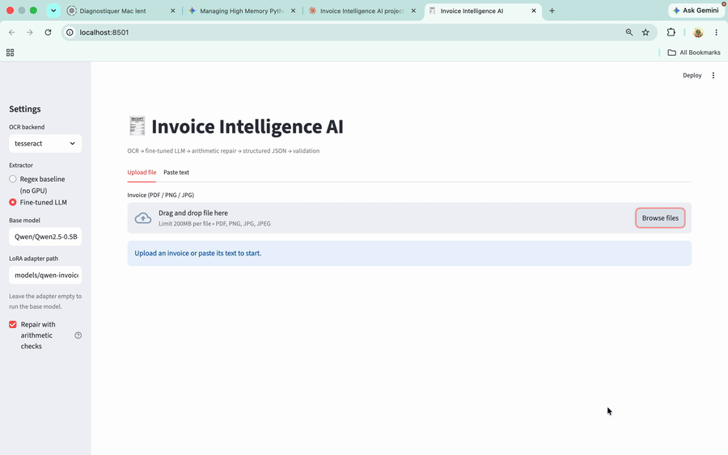

# Invoice Intelligence AI

> Photo or PDF of an invoice / receipt → OCR → fine-tuned small LLM → structured JSON → arithmetic repair → validation → Streamlit demo.

An end-to-end document-AI project built and trained entirely on a laptop. A **LoRA fine-tuned
Qwen2.5-0.5B-Instruct** turns noisy OCR text into a strict JSON schema, a deterministic **repair layer**
fixes the arithmetic mistakes a 0.5B model makes, and a **validation layer** tells the user what is still
inconsistent.

```
PDF / image ──► OCR (Tesseract, 2 preprocessing candidates) ──► text
            ──► fine-tuned LLM (LoRA) ──► JSON ──► repair (arithmetic + VAT recap) ──► Pydantic + checks ──► Streamlit
```



## Results (read this before the numbers)

Two very different measurements, because synthetic accuracy does **not** transfer to real tickets:

### 1. Synthetic test split (500 documents, seed 42, 67% invoices / 33% receipts)

| Method | Field accuracy | Exact match | Items correct |
|---|---:|---:|---:|
| Regex baseline (no LLM) | 0.53 | 0.00 | 0.00 |
| Base Qwen2.5-0.5B (no fine-tuning) | 0.54 | 0.07 | 0.40 |
| Fine-tuned (LoRA, `v5`) | **0.99** | **0.93** | **0.95** |

Measured on the first 40 documents of the held-out test split (seed 42, never used for training), scoring the
**raw model output, without the repair layer**. With n = 40 a single document moves a score by 2.5 points, so read
these as orders of magnitude, not precise values. The JSON was valid for 40/40 outputs, for every method.
Full per-field table: `results/v5_n40/eval_table.md`.
"Field accuracy" averages 9 fields: invoice number, vendor, invoice date, due date, currency, items, subtotal, tax, total;
"exact match" means all 9 are right at once.


### 2. Real receipts (4 tickets, hand-checked)

Four real tickets is **not a statistical sample**. Three of them were used while developing the system
(data generator, repair rules), so their scores are optimistic. Only the last one was never used for tuning.

| Ticket | Role | Latest result | Earlier models on the same ticket |
|---|---|---|---|
| Café, Morocco (DH) | development | 8/9 with `v5` + repair. The model returned quantity 14 × unit price 14; repair rule 3b was extended afterwards to handle it (re-test pending). | 6/9 (`v1`), 8/9 (`v2`) |
| Shop, France (EUR), 4 lines | development | ≈ 8/9 with `v3b` + repair (one product name misspelled by the OCR); not re-run with `v5` | 5/9 (`v1`), 6/9 (`v3b`, no repair) |
| Restaurant, France (EUR, VAT included) | development | 8/9 with `v5` + repair: all amounts right, 2 product names wrong | 4/9 (`v3b`) |
| Hotel restaurant, Switzerland (CHF, German) | **held-out** | 5/8 with `v5` + repair (subtotal not scored: the ticket is VAT-inclusive) | – |

Honest reading: the model gets dates, currencies and amounts right most of the time; it still copies OCR
noise into product names, misses invoice numbers whose label it has never seen (e.g. German "Rech.Nr."), and
only keeps the first line of a vendor name split over two lines. See *Limitations*.

### 3. What the repair layer adds (synthetic stress test)

Correct model outputs are never modified (**0 changes on 12,000 generated documents**). On deliberately broken
outputs of 6,000 receipts, share of the three amount fields (subtotal, tax, total) that are correct:

| Broken output | Before repair | After repair |
|---|---:|---:|
| subtotal and total are garbage (e.g. a postal code), tax random | 0.00 | 0.77 |
| same, and the printed total was lost by the OCR | 0.00 | 0.74 |
| total is garbage | 0.67 | 0.96 |
| tax is wrong | 0.67 | 0.84 |
| tax and total swapped | 0.33 | 0.91 |

The repair made no case worse in these scenarios. These numbers are measured on the same synthetic family the
rules were designed with, so treat them as an upper bound for real tickets.

## How it works

**OCR** (`src/ocr.py`). PDFs with a text layer are read with PyMuPDF; images go through Tesseract (`eng+fra`).
Two preprocessed versions of the image are produced (light clean-up, and upscale + sharpen + shadow removal +
Otsu threshold); the one whose text looks more plausible (valid dates, no digit-lookalike noise) is kept.
PaddleOCR is available as an optional backend (untested).

**Synthetic data** (`src/generator.py`). Invoices and POS receipts are rendered *from* gold JSON, so labels are
exact: EN/FR, EUR/USD/GBP/MAD, several number and date formats, three invoice layouts, five receipt layouts
(including `1 ENTRECOTE 25.00 25.00` and PU/Qté/PT columns), tax-exclusive and tax-inclusive totals with one or two
VAT rates, tickets with no number at all, distractor lines (postal code, SIRET, phone, table number), and OCR-style
noise (garbled words, lost accents, junk lines, a lost quantity cell). OCR noise never alters a digit.

**Fine-tuning** (`scripts/train_lora.py`). Plain PyTorch loop, LoRA r=16 / alpha=32 on 7 projection modules
(8.8 M trainable parameters of 503 M), loss on the assistant's JSON only, float32 on Apple Silicon (MPS).
Trained in successive rounds (`v1` … `v5`) with `--resume` and a different `--data-seed` each time, so the
evaluation seed (42) is never seen. Batches are padded to a multiple of 64 tokens: without that, MPS recompiles
for every new sequence length and training slows down step after step.

**Repair layer** (`src/postprocess.py`). Deterministic rules, every change reported to the user:
quantity × unit price = line total, sum of lines = subtotal, tax-exclusive or tax-inclusive totals, VAT recap parsed
from the ticket (`TVA 19,60 0,52 / HT TVA 19,60 2,68`), a lost quantity cell restored, a "ticket number" that is really
a postal code / SIRET removed, and a subtotal or total printed nowhere on the document replaced by the sum of the lines.

**Validation** (`src/validation.py`). Pydantic schema + consistency checks, with three severities: `error` (vendor or
total missing), `warning` (the numbers do not add up), `info` (no ticket number printed; tax already included in the total).

## Output schema

```json
{
  "invoice_number": "INV-2026-1042",
  "vendor": "ACME SOFTWARE",
  "invoice_date": "2026-09-12",
  "due_date": "2026-10-12",
  "currency": "USD",
  "items": [{"description": "Python Course", "quantity": 1, "unit_price": 120.0, "total": 120.0}],
  "subtotal": 200.0, "tax": 40.0, "total": 240.0
}
```

Tax conventions: tax-exclusive → `subtotal + tax = total`. Tax-inclusive (typical of shop tickets) → `subtotal` is
the sum of the lines, equal to `total`, and `tax` is the VAT already contained in it. No tax printed → `tax: null`.

## Quick start

```bash
pip install -r requirements.txt
sudo apt install tesseract-ocr tesseract-ocr-fra        # macOS: brew install tesseract tesseract-lang
python scripts/generate_dataset.py --n 5000 --seed 42   # writes data/{train,validation,test}.json
pytest -q                                               # 8 tests
streamlit run app/streamlit_app.py
```

The app works without a GPU in "Regex baseline" mode. For the fine-tuned model, train an adapter (below) or
download one, then set its folder in the sidebar (default `models/qwen-invoice-lora-v5`).

## Training and evaluation (local, no cloud needed)

```bash
# first round: invoices + receipts
python scripts/train_lora.py --train-size 600 --epochs 2

# continue an adapter on new data (new seed, more receipts)
python scripts/train_lora.py --resume models/qwen-invoice-lora-v4 --out models/qwen-invoice-lora-v5 \
    --data-seed 46 --receipt-ratio 0.7 --train-size 320 --epochs 1 --batch 1 --grad-acc 4 --lr 1e-4 --save-every 5

# evaluate (scores raw model output; Ctrl+C evaluates what is finished)
python scripts/evaluate_model.py --adapter models/qwen-invoice-lora-v5 --n 40 --with-base
```

On a MacBook the v5 round (80 optimizer steps) takes about 8 minutes once the MPS shape issue above is handled.

## Limitations

- **Tiny real test set.** Four tickets; three were used during development. High scores on synthetic data
  say little about real documents.
- **Languages and currencies.** Trained on English and French only (EUR, USD, GBP, MAD). German, other scripts
  and handwriting are out of scope; invoice-number labels it has never seen often come back as `null`.
- **Vendor names on several lines** are truncated to the first line.
- **Product names** inherit OCR errors, sometimes with price fragments glued on.
- **The repair rules were tuned on a handful of tickets** and are conservative by design; they cannot fix lines
  the model read wrongly, only the arithmetic around them.
- **A 0.5B model is weak at arithmetic**, which is exactly why the repair layer exists.
- Single-page documents, printed text, one ticket per image.

## Roadmap

1. Annotated real-ticket test set with a scoring script and a "with / without repair" comparison.
2. More invoice-number labels and languages, vendor names over two lines, `2x item à price` lines in the generator.
3. Strip price fragments from product names in the repair layer.
4. Mix in public data (SROIE / CORD) and evaluate on 100+ real documents.
5. Publish the LoRA adapter on the Hugging Face Hub.

## Project layout

```
src/        generator, preprocessing, schema, validation, postprocess (repair), evaluation, baseline, ocr, inference, utils
scripts/    generate_dataset.py, train_lora.py, evaluate_model.py
app/        streamlit_app.py
tests/      test_pipeline.py
data/       generated JSON (git-ignored) + samples.txt
models/     LoRA adapters (git-ignored; only models/README.md is committed)
notebooks/  optional exploration notebooks (training runs from scripts/, locally)
```

## Credits

Base model: [Qwen/Qwen2.5-0.5B-Instruct](https://huggingface.co/Qwen/Qwen2.5-0.5B-Instruct) (check its license on the
model card). Built with PyTorch, Hugging Face Transformers + PEFT, Pydantic, Tesseract, PyMuPDF and Streamlit.
All vendor and client names in the synthetic data are invented.